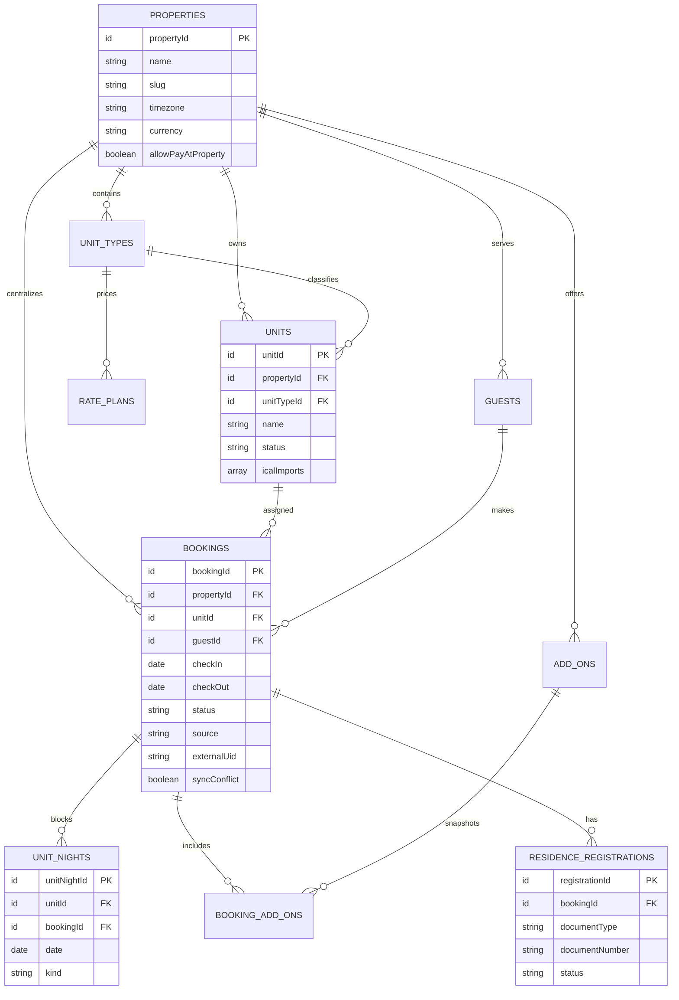

# ERD và Data Dictionary

## Ràng buộc quan trọng

- Mỗi căn/ngày chỉ được cấp cho một booking thông qua kiểm tra `unitNights` trong transaction.
- `checkOut` là ngày loại trừ.
- `externalUid` kết hợp với căn và nhãn nguồn bảo đảm import idempotent.
- Booking iCal giữ đủ khoảng ngày ngay cả khi có xung đột; chỉ các đêm còn trống được tạo `unitNights`.
- Booking đã hủy không giữ `unitNights`.
- `bookingAddOns` lưu snapshot để thay đổi danh mục dịch vụ không sửa lịch sử.

